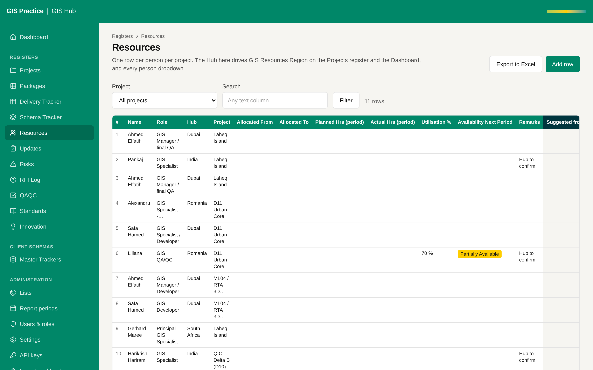

# 01 - Shared project key and the planner link

Current screen: Resources register of the Hub, typed by hand.

## Today

- The Resources register is typed by hand in the Hub, while the same people and hours already sit in the Resource Planner.
- The two systems share no key: the Hub has Project Name and Job No., the planner has Project Number.

## The change

- One key on both sides (see proposal 02).
- A sync job that reads the planner feed and fills the Resources register: person, role, hub, planned and actual hours.
- A rule for conflicts: the planner wins on hours, the Hub wins on GIS role and remarks.
- A "last synced" line on the register and a manual "Sync now" button for the GIS Manager.

## Benefit for the team

- No double entry of the team and the hours.
- Team utilisation on the Dashboard comes from the planned hours, not from a typed figure.
- A project update can show planned against actual hours.

## Effort and dependencies

- Effort: Large - 2 to 3 weeks
- Depends on: Proposal 02 (the key) and proposal 03 (the feed).

## Needs your decision or confirmation

- Which system is the master for the project list: the planner or the Hub?
