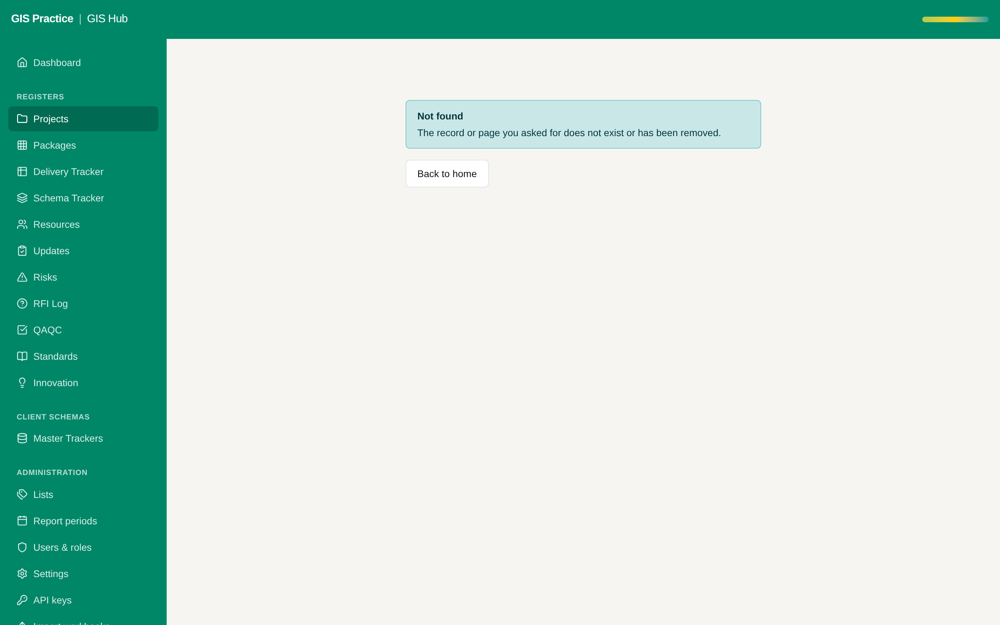

# 02 - Project number on the Hub project

Current screen: Project form of the Hub: Project Name and Job No., no Project Number.

## Today

- A Hub project is identified by its name. Job No. is optional free text.
- The planner keys on Project Number. A match on names is not safe (ML04 / RTA and ML04 - RTA are the same project).

## The change

- A Project Number field on the project, unique, shown on the register, the forms and the exports.
- The import reads it from a new column of the Projects sheet, and warns when it is missing.
- A one-off screen to fill the number for the existing projects.

## Benefit for the team

- The number the team already uses on paper becomes the reference in the Hub.
- It is the condition for every link to the planner (proposals 01, 13, 14, 17).

## Effort and dependencies

- Effort: Medium - 2 to 3 days
- Depends on: None.

## Needs your decision or confirmation

- Is the planner Project Number the master, or the Hub Job No.? Needs your confirmation.
- A new column on the Projects sheet of the workbook changes the sheet layout: confirm before I add it.
