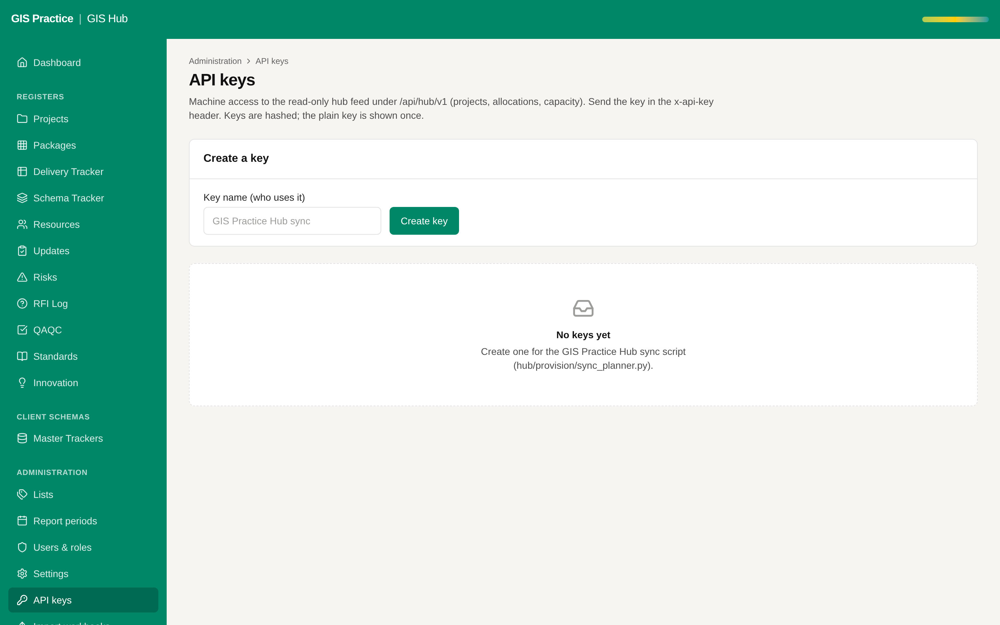

# 03 - Incremental feed with pagination and per-client keys

Current screen: API keys page of the Hub.

## Today

- The feed returns everything on every call and every key can read every register.
- Note: the text on this page still describes the planner feed ("allocations, capacity", "sync_planner.py"). It is corrected with this item, or on its own in an hour.

## The change

- A "since" parameter so a consumer asks only for what changed.
- Pages of 500 rows with a cursor.
- A scope on each key: which registers and which hubs it may read.
- An audit line for each read by a key.

## Benefit for the team

- Power BI, the planner or a client each get their own key, which can be revoked alone.
- The feed stays fast when the registers grow.

## Effort and dependencies

- Effort: Medium - 3 to 4 days
- Depends on: Proposal 01 uses it on the planner side.

## Needs your decision or confirmation

- Will a client ever read the feed directly? If yes, the key scope becomes a must before any client key is issued.
