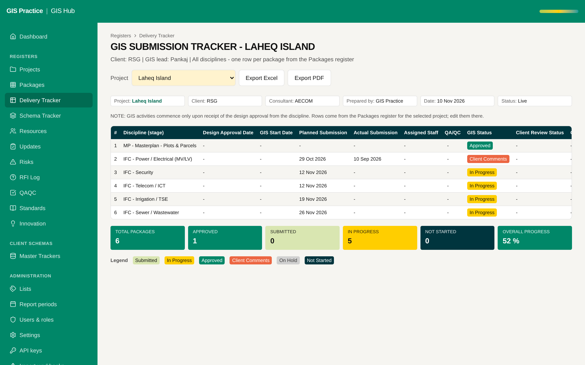

# 04 - Exports in the workbook layout with embedded Arial

Current screen: Delivery Tracker with its Export Excel and Export PDF buttons.

## Today

- The Excel export carries the AECOM tokens and Arial, but not the header block and the side-by-side layout of the workbook.
- The PDF does not embed Arial, so it can print in another font on a PC without it.

## The change

- Excel: the header block (Project, Client, Consultant, Prepared by, Date, Status), dd-mmm-yyyy dates and the sheet colours.
- PDF: Arial embedded, A4 landscape, the same layout as the sheet.
- The bi-weekly project update gets the same two exports.

## Benefit for the team

- An export can go to a client without being reformatted.
- The team stops copying the Hub back into the workbook to send it.

## Effort and dependencies

- Effort: Medium - 3 to 4 days
- Depends on: None.

## Needs your decision or confirmation

- A reference export approved by you is needed first (one tracker and one project update), so "matches the workbook" can be tested.
