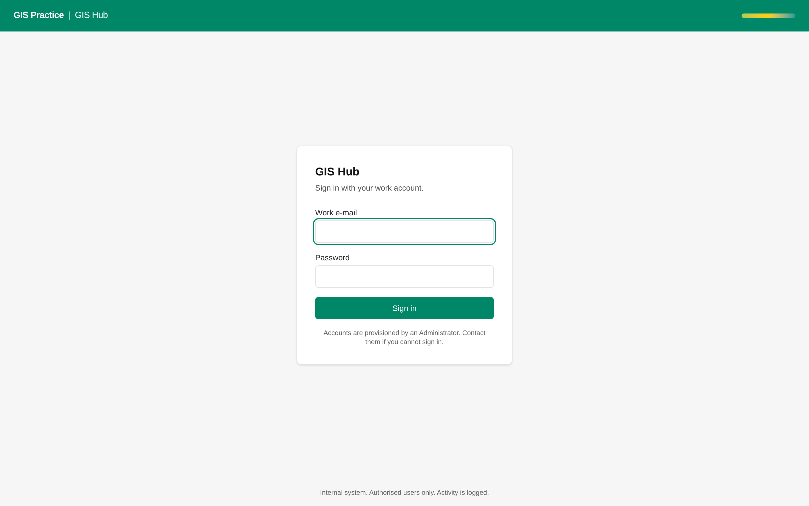

# 05 - Entra ID sign-in

Current screen: Sign-in page of the Hub with a local e-mail and password.

## Today

- Each user has a local password in the Hub and another one in the planner.
- Joiners and leavers are handled by hand under Users & roles.

## The change

- "Sign in with AECOM" on both applications. The code path exists; it needs the registration.
- Roles from Entra groups (for example GIS-Hub-Manager), with a manual override for the GIS Manager.
- Local passwords switched off once everyone has signed in once.

## Benefit for the team

- No passwords to manage, and multi-factor sign-in from the AECOM tenant.
- A leaver loses access the day IT disables the account.

## Effort and dependencies

- Effort: Large in calendar time, about 2 days of work once IT has registered the applications
- Depends on: AECOM IT: application registration, redirect URI, the groups.

## Needs your decision or confirmation

- Needs an IT request raised by you. I can draft it.
