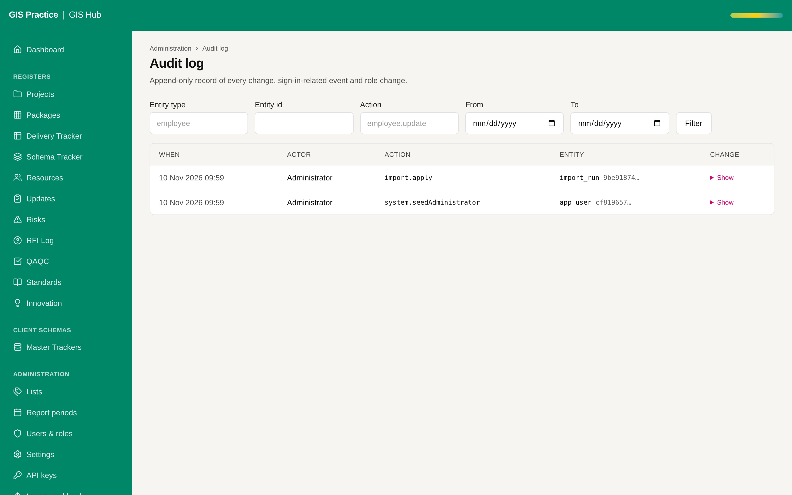

# 06 - Central logging and alerting

Current screen: Audit log of the Hub: who changed what. Technical errors are not here.

## Today

- The audit log shows data changes. Technical errors go to the Render log only, kept for a short time.
- Nobody is told when the application is down. On 2026-11-10 the Updates page failed and it was found by opening the page.

## The change

- A log drain to the AECOM log platform (or Azure Monitor).
- An uptime check on /api/health every 5 minutes with an e-mail to the GIS Manager.
- An alert on any server error, with the reference number the user sees.

## Benefit for the team

- A failure is known in minutes, with the cause, not when a user complains.
- Logs survive a restart and can be searched.

## Effort and dependencies

- Effort: Medium - 2 days once the destination exists
- Depends on: AECOM IT for the destination. An interim uptime check on Render needs your go (a Render change).

## Needs your decision or confirmation

- Which log platform does AECOM IT allow?
