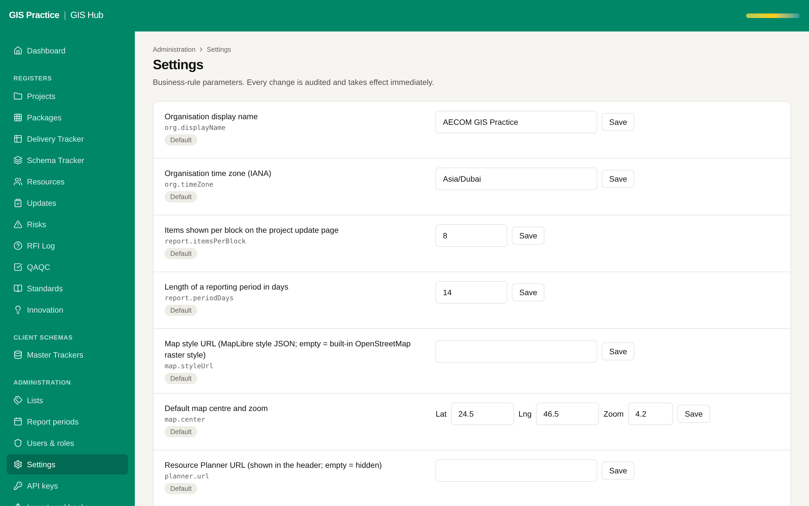

# 07 - Key Vault for the secrets

Current screen: Settings page of the Hub. The secrets themselves live in the Render environment.

## Today

- The database address, the sign-in secret and the job token are Render environment variables.
- Anyone with the Render account can read them, and no log says who did.

## The change

- The secrets move to Azure Key Vault; the applications read them at start.
- Rotation every 90 days with a documented step.

## Benefit for the team

- One audited place for the secrets, as AECOM security expects for real project data.

## Effort and dependencies

- Effort: Medium - 2 days once the vault exists
- Depends on: AECOM IT. Makes sense together with proposal 08.

## Needs your decision or confirmation

- Not worth doing on Render alone: do it with the move to the AECOM server.
