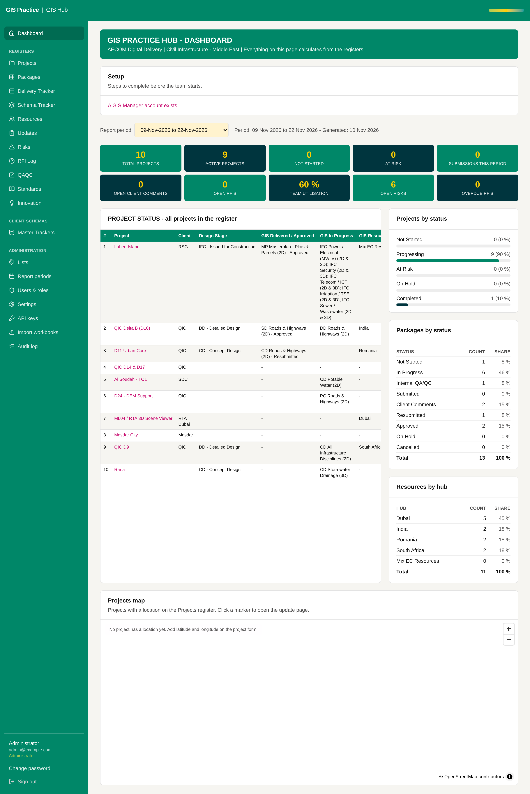

# 08 - Move both applications to the AECOM server

Current screen: The Hub as it runs today on Render, on sample data only.

## Today

- Both applications run on Render. By rule they hold sample data only, so the Hub cannot replace the workbook for live projects.

## The change

- A host inside AECOM (VM or container service), PostgreSQL, HTTPS on an AECOM name.
- Deployment from GitHub, migrations as a separate approved step, backups (proposal 16).
- A cutover plan: freeze, import the real workbook, check the parity numbers, go live.

## Benefit for the team

- Real client and project data may be held. This is the step that makes the Hub the live system.
- Access only from the AECOM network.

## Effort and dependencies

- Effort: Large - 2 to 4 weeks, mostly IT lead time
- Depends on: Proposals 05, 06 and 07, and AECOM IT.

## Needs your decision or confirmation

- Needs an IT hosting request and a named IT contact. This is the main decision of the list.
