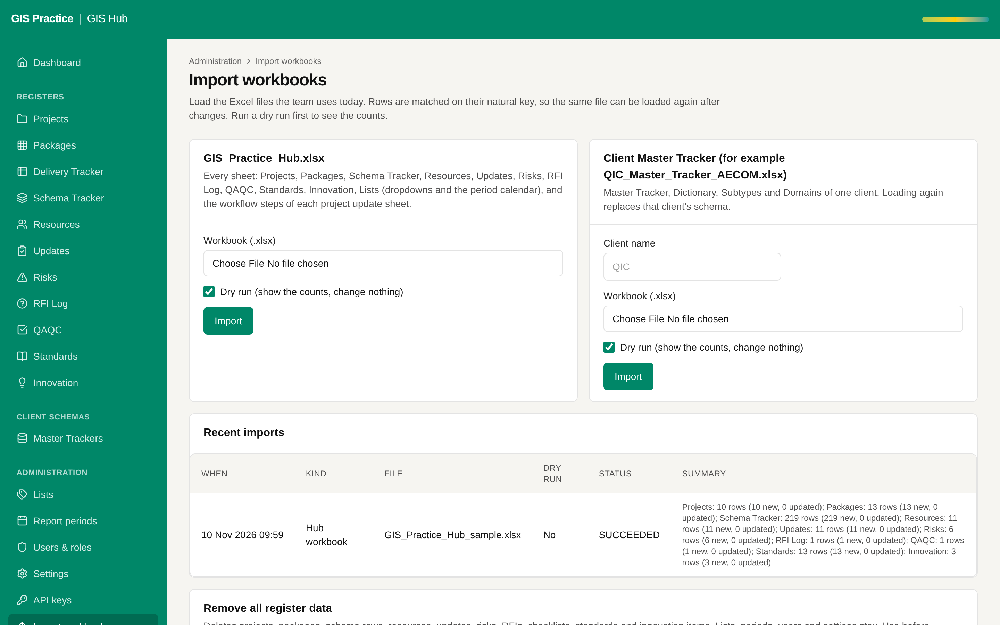

# 09 - A second database for the Hub

Current screen: Import page of the Hub. Hub and planner data sit on one database instance.

## Today

- The Hub and the planner use two databases on one Render instance.
- A problem on the instance, or a restore, touches both.

## The change

- Its own instance for the Hub, with its own backups and restore.

## Benefit for the team

- A wipe, a restore or a heavy import on one application cannot affect the other.

## Effort and dependencies

- Effort: Small - half a day on a new host
- Depends on: Proposal 08. On Render it means a second paid instance.

## Needs your decision or confirmation

- Do it as part of the move, not before.
