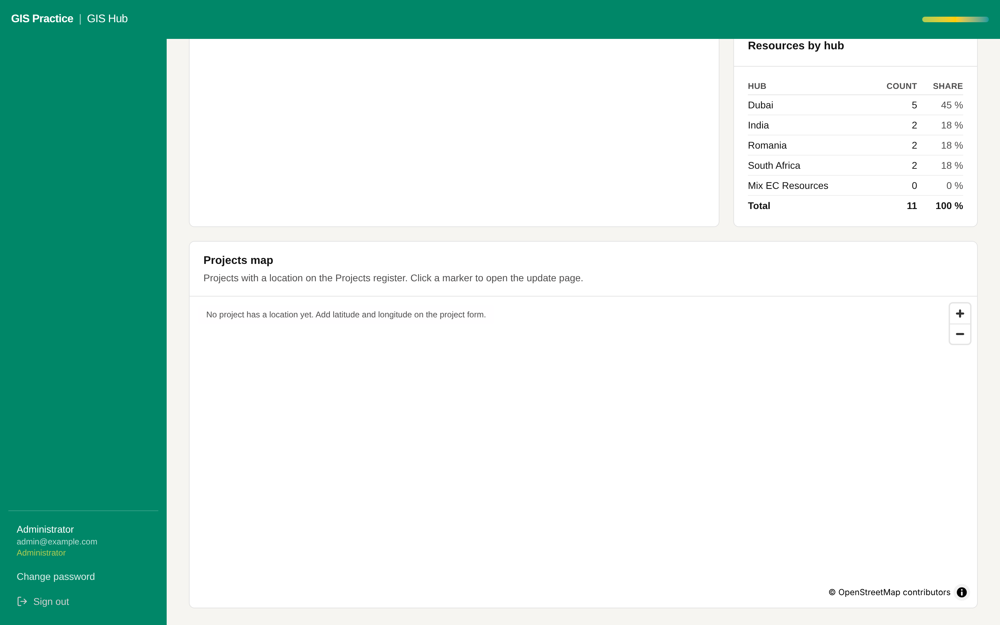

# 10 - Map tiles that work on the AECOM network

Current screen: Projects map on the Dashboard. No project of the sample has a location yet.

## Today

- The map loads its background from the public OpenStreetMap servers, which the office network may block.
- No project of the sample has a latitude and longitude, so the map is empty.

## The change

- The background from an approved source: the AECOM ArcGIS basemap or a cached style.
- Latitude and longitude filled on the project form, or picked on the map.

## Benefit for the team

- The map works inside the office and shows the projects.

## Effort and dependencies

- Effort: Small - 1 day
- Depends on: AECOM IT or the GIS platform team to name the allowed basemap.

## Needs your decision or confirmation

- Which basemap service may the Hub use? Client confirmation is needed if a client basemap is used.
