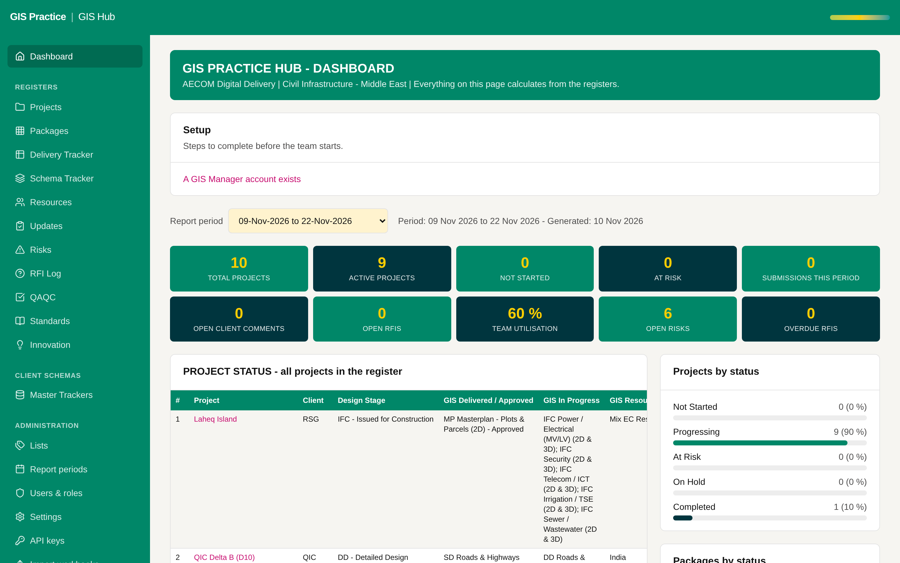

# 11 - Dashboard period as a manager-owned setting

Current screen: Dashboard with the Report period selector.

## Today

- Each user picks the report period for themselves; the default is the period of today.
- In the workbook one cream cell sets the period for everyone.

## The change

- A "current report period" set by the GIS Manager under Report periods.
- Everyone opens the Dashboard and the project updates on that period; a user can still look at another one.

## Benefit for the team

- The team and the manager look at the same numbers in the bi-weekly review.
- It matches the workbook.

## Effort and dependencies

- Effort: Small - 1 day
- Depends on: None.
