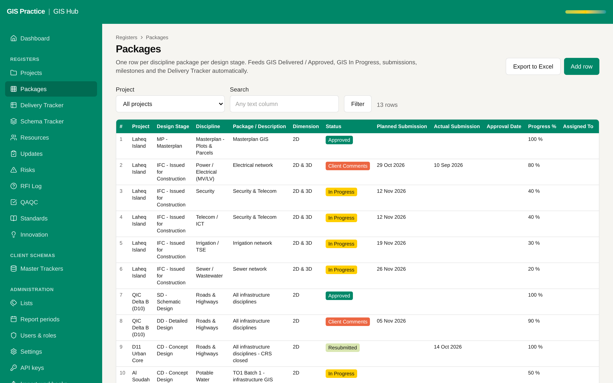

# 12 - Remaining accessibility and contrast items

Current screen: Packages register with the status chips.

Status: built on 2026-11-10 (branch `feat/accessibility-contrast`). The screenshot shows the screen before the change.

Measured result: the yellow and light green chips already pass WCAG AA (dark text, 12:1 and 14:1). The one
failing pair was white text on the coral fill ("Client Comments", "Red", "Fail"), 3.2:1. It now uses dark text
on the same fill (5.8:1).

## Today

- Some status chips (yellow "In Progress", light green "Submitted") have low text contrast.
- Long register tables are slow to cross with the keyboard.

## The change

- Chip colours checked against WCAG AA, using only the AECOM tokens and their tints.
- A sticky first column and header, and keyboard shortcuts to jump between rows.
- A check in CI that fails on a new contrast problem.

## Benefit for the team

- Readable on a projector and for colleagues with low vision.
- Meets the AECOM digital standard before a wider roll-out.

## Effort and dependencies

- Effort: Small - 1 to 2 days
- Depends on: None.

## Needs your decision or confirmation

- Chip colours follow the workbook sheet colours today. A darker text on the same fill keeps the design intent; confirm if you prefer that to a new fill.
