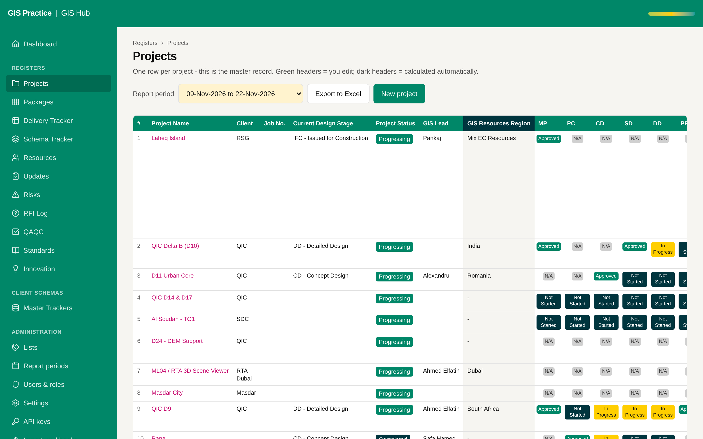

# 13 - Reconciliation report for unmatched projects

Current screen: Projects register of the Hub.

## Today

- Nothing shows which projects exist in the planner but not in the Hub, or the other way round.

## The change

- A page for the GIS Manager: in both, only in the Hub, only in the planner, with the differences in name, client and GIS lead.
- A link to create the missing project on the other side.

## Benefit for the team

- The link between the systems cannot silently drop a project.

## Effort and dependencies

- Effort: Small - 1 day once the key exists
- Depends on: Proposals 01 and 02.
