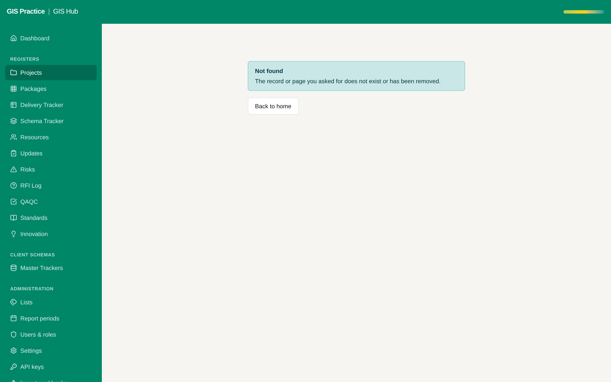

# 14 - Planner field for the Hub status

Current screen: Project update page of the Hub with its status. The planner does not show it.

## Today

- A planner user who wants the GIS delivery status opens the Hub and searches the project.

## The change

- The planner project page shows the Hub status, the overall progress and the next milestone, read from the Hub feed.
- A link "Open in GIS Hub".

## Benefit for the team

- Project managers see the GIS status where they already plan the people.

## Effort and dependencies

- Effort: Small - 1 day
- Depends on: Proposals 01 and 02.
