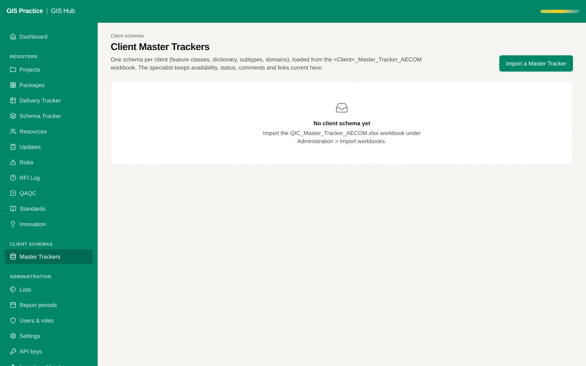

# 15 - Coverage of the untested services

Current screen: Master Trackers (client schemas), one of the services without tests.

Status: Hub part built on 2026-11-10 (branch `test/coverage-untested-services`). Line coverage of the
domain and application code went from 80 % to 89 %; project extras, client schemas, API keys and the
overview are at 100 %. The Planner part follows in the planner repository.

## Today

- Tested today: import, registers, lists, periods, settings, scope, parity. Not tested: project extras, client schemas, feed, API keys, audit read; in the planner the GIS import, bids import, calendars, staff roles, clients and job token.
- Two defects reached the live Hub on 2026-11-10 because the tests always ran on a loaded database: the Updates page on an empty register, and the workflow strip read as applications.

## The change

- Tests for each untested service, one file at a time, to 60 % lines and above.
- Every page opened once on an empty database and once on the sample, in the end-to-end run.

## Benefit for the team

- A change cannot break these screens unnoticed.
- The two defects of 2026-11-10 would have been caught before the merge.

## Effort and dependencies

- Effort: Medium - 3 to 4 days, can be split
- Depends on: None.
