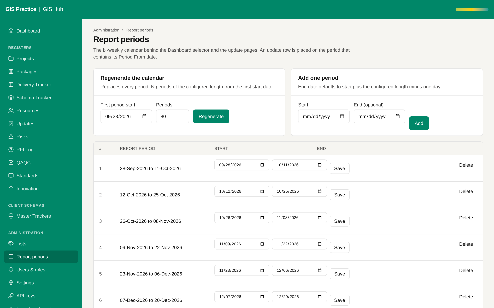

# 16 - Scheduled backups and a restore test

Current screen: Report periods, an example of setup data that would be lost with the database.

## Today

- Render keeps point-in-time recovery for 3 days and manual exports for 7 days. No copy exists outside Render.
- A restore has never been rehearsed.

## The change

- A nightly export to AECOM storage, kept 30 days.
- A restore rehearsal every quarter, with the time it took written in the handover.

## Benefit for the team

- A backup that has been restored once is a backup. Today it is an assumption.

## Effort and dependencies

- Effort: Small - 1 day per environment
- Depends on: Proposal 08 for the AECOM side. On Render it needs an IP on the allow list, which is your decision.

## Needs your decision or confirmation

- Until then: one manual export before each bulk import, as already advised.
