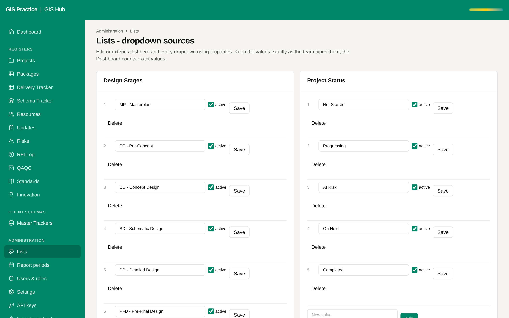

# 17 - Hub value mapped from the planner team names

Current screen: Lists page of the Hub with the Hub / Region list.

## Today

- The Hub uses India, Romania, South Africa, Dubai and Mix EC Resources. The planner uses team names.
- A row synced from the planner would carry a team name the Hub does not know.

## The change

- A small mapping table: planner team to Hub value, kept by the GIS Manager next to the Hub / Region list.
- The sync refuses a row with an unmapped team and lists it.

## Benefit for the team

- Region scope and "Resources by hub" stay right when the people come from the planner.

## Effort and dependencies

- Effort: Small - half a day
- Depends on: Proposals 01 and 03.
